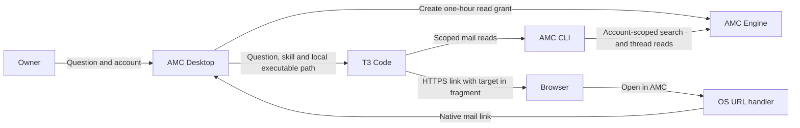

# Ask Agent uses a scoped local CLI and shared mail links

AMC’s command palette sends an explicitly submitted question to a new local T3
Code thread. The user chooses **Ask Agent in T3**. The current account selection
sets the search grant’s account ceiling. All Accounts grants read access across
the Engine’s accounts.

Desktop Main uses the existing local T3 launcher. It resolves the configured AMC
feedback project or a unique active project named **AMC**, and verifies that its
workspace contains the AMC skill. T3 reads the skill from that checkout. Desktop
creates an expiring executable in the private AMC profile. The initial T3 prompt
contains the executable path. The executable supplies a dedicated Engine read
grant to `amc --as-agent`. The Engine checks the grant and expiry on every call.
Account-scoped grants cannot read Engine-wide operational health data.
When T3 supports an explicit runtime mode, AMC requests approval-required. The
installed local CLI can inherit the project's runtime mode. The palette displays
the effective mode when it can read the setting. This is scoped access
to AMC through the provided executable. T3 retains its configured access to the
local machine and model provider.

The Engine owns search syntax, ranking, and results. Owner HTTP and agent MCP
share the same queries. FTS5 supplies text matches over indexed subject, people,
body and attachment names. Message metadata supplies directional and date
filters. All predicates apply to one message. Results select one best message
per thread before paging. Existing array shapes support offset pagination.
As the mailbox changes between pages, the ordering can change.

The protocol package owns `amc://thread/<encoded-id>` and
`amc://search?q=<query>&accountId=<optional-id>`. Both require an `engine`
query parameter identifying the paired Engine origin. The CLI emits these links or
an HTTPS variant on the paired Engine. Desktop Main validates native links and
holds them until mailbox navigation is ready. It uses the notification route to
select a thread in the local replica, fetching sync changes when a live replica
is missing the thread or a linked account. Desktop checks the Engine origin
before dispatching an intent and again before executing a linked search. A search
link sets the account and query together. Search URLs carry the literal query.
Both URL forms leave credentials in the app.

The installed T3 chat strips unknown schemes from Markdown and its Electron
shell separately validates allowed destinations. The HTTPS variant reaches a
small Engine page with an **Open in AMC** action. The target lives in the
fragment, so neither the Engine request nor its logs receive the query or
thread ID from that visit. The page reads no mail. A native T3 integration
would remove the browser step and require changes in both the chat renderer and
its Desktop URL handler.

The existing CLI and FTS index keep the data path offline from the providers.
Adding a separate semantic index would introduce another copy of mail and a
second result model. This first version uses the index AMC already updates as
mail syncs. For future indexing decisions, benchmark broad text queries and
sender-only queries separately.

[Electron deep links](https://www.electronjs.org/docs/latest/tutorial/launch-app-from-url-in-another-app) · [SQLite FTS5](https://sqlite.org/fts5.html) · [CLI examples](../agents/cli.md)
