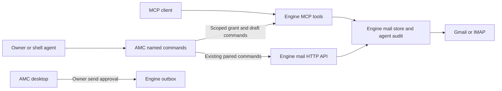

# Mail from the AMC CLI

Use a paired `amc` for owner commands. For an agent, pass a scoped grant through
`AMC_TOKEN` and run commands with `--as-agent`. Set `AMC_ENGINE_URL` when the
Engine URL differs from the local pairing or the machine has no pairing.
Agent mode requires an Engine that recognizes and verifies scoped CLI access.
It uses the explicit token for every request.

```sh
amc --as-agent search --account <account-id> --json 'subject:Project'
amc --as-agent thread <thread-id> --json
amc --as-agent reply <thread-id> --body-file - --json < reply.txt
amc --as-agent draft create --account <account-id> --to reader@example.com \
  --subject 'Project update' --body-file update.txt --json
amc --as-agent draft show <draft-id> --json
amc --as-agent draft update <draft-id> --revision <revision> --body-file revised.txt --json
```

## Find mail and open it in Desktop

```sh
amc search --json -- 'from:alice@example.test "annual budget" after:2026-11-23'
amc search --json --limit 50 --offset 50 -- 'from:alice@example.test'
amc link thread -- 'account:thread'
amc link search --account account -- 'from:alice@example.test'
amc link search --web -- 'subject:"annual budget"'
```

Combine free text with `from:`, `to:`, `cc:`, `subject:`, `after:`, and
`before:`. Each term and filter applies to the same message. Person filters
match a full email address exactly or a literal substring of the name or
address. Use quotes around a phrase or multiword field value. `after:` starts
at the given YYYY-MM-DD in UTC, inclusive. `before:` ends at the given UTC day,
exclusive. Date filters apply to the message timestamp. Search covers synced,
indexed mail, including attachment filenames.

Add `--offset` to retrieve further results. Count threads already returned
and stop when a page is shorter than the limit. To reuse the same search in
AMC, pass its query and account to `link search`. Use `--web` for T3 chat,
then choose **Open in AMC** on the Engine page. Search links include the query
in the URL. Copy them where that query can be shared.

In AMC Desktop, open **Commands & Ask Agent** in the sidebar or press **⌘K**.
Type your question and select **Ask Agent in T3**. This requires the local
T3 Code CLI, an active AMC project pointing at an AMC checkout, and the
current AMC CLI installed via `pnpm cli:install`. Update the Engine and
Desktop to the same release for paging and browser links.

Use `--reply-all` to include the other thread recipients. Repeat `--to`, `--cc`,
or `--bcc` to override a recipient field. Each takes an address or
`'Name <address>'`. Pass an empty value by itself to
clear that field. Draft writes return the AMC ID, revision, and current provider
mirror status when supported. Draft-only grants receive a receipt without mail
content. If a draft changed, inspect the new revision before editing or
discarding it. If the Engine loses the response to a write, check AMC before
retrying. Send the reviewed draft from AMC desktop.

For agent batches, add up to 19 more distinct thread IDs with repeatable
`--thread <id>`. A queued action returns an ID you can check with
`amc --as-agent agent status <action-id> --json`.

| Operation | Command |
| --- | --- |
| Grant, accounts, labels | `whoami`, `accounts`, `labels` |
| Mail and contacts | `threads`, `thread`, `message`, `search`, `contacts` |
| Drafts | `draft create`, `reply`, `draft list`, `draft show`, `draft update`, `draft discard` |
| Organize and check writeback | `archive`, `read`, `unread`, `star [--remove]`, `mute`, `label [--remove]`, `agent status` |
| Agent triage and suggestions | `triage untriaged`, `bucket`, `senders suggest` |

Discard requires the paired owner. Handoff grants support `thread`, `draft show`,
and body-only `draft update` for their assigned items. Account-scoped grants
cannot search the owner’s shared contacts. Lease-bound model predictions and
review context belong to the triage runner.

## Authorization and state



The Engine owns draft state, thread state, provider writeback, and audit.
Scoped commands and revision-checked owner writes use versioned MCP routes.
The Engine checks the credential before dispatching, and an older Engine
rejects those routes even if a rollback happens between discovery and the
write. The CLI checks which draft fields the grant can edit. Existing paired
reads and owner mutations retain their HTTP behavior and output shapes.
