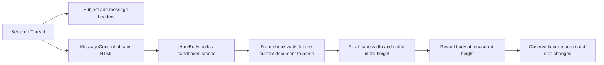

# HTML email first paint in the desktop reader

Show the selected Thread and sender as soon as their data is available. Reveal each HTML body once Chromium has parsed it and AMC has sized it at the current pane width. The body should be readable while permitted images are still loading.

## Evidence

The recording shows the newsletter as a clipped strip from 2.183 s to 2.550 s, a 367 ms interval. Its top edge, subject, and sender stay in place as its bottom edge expands. The recording contains no resource or application trace that identifies what delayed that particular iframe.

On AMC commit `4364422`, an isolated Electron run with synthetic mail reproduced the same sequence. The image server delayed its response by 350 ms. The image had explicit dimensions and the position of the last text line stayed constant. Times below are individual runs sampled with `requestAnimationFrame` from the row click.

| Approach | First visible body | When the image finished |
| --- | --- | --- |
| Current reader | 28 ms at 120 CSS px, clipping the document | Body grew to 910 px at 386 ms |
| Hide until iframe `load` | 383 ms at 910 px | Body became visible after the image finished |
| Size at parsed-document readiness, then reveal | 31 ms at 910 px | Body stayed at 910 px |

With remote images blocked, the current reader still exposed the short frame for one sampled frame and made zero image requests. With early sizing and the image’s explicit height removed, the body opened at 806 px at 40 ms and grew to 910 px at 391 ms. The first issue is an avoidable wait to measure existing layout. The second is a change to the layout itself as intrinsic dimensions become available.

Height-dependent sender CSS also matters. In the existing Electron height-feedback fixture, a frame sample recorded 334 px, then 154 px, then 334 px with internal scrolling enabled. The sender’s media query changes the content height in response to the frame height. Revealing after the first measurement alone can expose that sizing cycle. [Height-feedback fixture](../../apps/desktop/src/renderer/src/dev/html-reader-fixtures.ts#L45) · [Existing convergence test](../../test/electron/html-reader.mjs#L254)

## Where the fix belongs

The selected Thread supplies the header and message list. `MessageContent` obtains the HTML and resolves supported CID attachments before passing it to `HtmlBody`. The frame hook then receives the sanitized `srcdoc`, starts at 120 px, and initializes sizing only on the iframe’s `load` event. Chromium can reach `interactive` after parsing while resources are still pending. The measured state belongs to the individual iframe and its current document. The mailbox owns selection and the outer scroll viewport. [Body loading](../../apps/desktop/src/renderer/src/features/thread-reader/message-content.tsx#L95) · [Frame rendering](../../apps/desktop/src/renderer/src/components/message-body.tsx#L80) · [Frame lifecycle](../../apps/desktop/src/renderer/src/components/use-message-frame.ts#L12) · [HTML document readiness](https://html.spec.whatwg.org/multipage/dom.html#current-document-readiness)

Early sizing preserves the useful part of the current experience, immediate feedback from the header and the earliest readable email body. Waiting for `load` hides the strip at the cost of tying time to readable text to image latency. HTML lookahead can shorten the earlier data-loading stage and still leaves this iframe paint sequence in place. A viewport-height iframe would avoid automatic height negotiation by introducing a second scrolling surface for ordinary messages. Reuse native iframe layout and the existing internal-scroll fallback for documents whose size depends on the viewport. [Archive lookahead baseline](../../test/renderer/README.md#inbox-archive-advance) · [Sizing and scroll fallback](../../apps/desktop/src/renderer/src/components/use-message-frame.ts#L67)

## Implementation

1. **Add the Electron regression first.** Add a tall HTML fixture with one remote image that has explicit dimensions. Hold its response at the loopback server until the test releases it. Sample the actual iframe from the click, including its visibility, document identity, height, and the position of a final text marker inside it. Assert that the first visible body fits the marker while the response is held. Run the test on the current reader and capture the failure. Keep a before and after capture from the synthetic fixture. [Electron harness](../../test/electron/html-reader.mjs#L17) · [Loopback image server](../../test/electron/html-reader-server.mjs#L31)
2. **Start sizing from the parsed document.** Keep `srcdoc` and its existing sandbox and CSP. Start parent-side document discovery when AMC assigns new HTML. Once the current `about:srcdoc` document is available, use `readyState` and `readystatechange` to initialize at `interactive` or `complete`. Retain iframe `load` as a fallback and make initialization idempotent per document. Stop frame polling once the document is found and cancel all listeners, scheduled work, and observers on replacement or unmount. Fence publication by the current navigation and `Document` identity. Both old and new documents have the same URL, so test rapid source replacement and correlate with an AMC-generated navigation marker if event ordering makes identity alone ambiguous. [Frame lifecycle](../../apps/desktop/src/renderer/src/components/use-message-frame.ts#L12) · [Sandbox document construction](../../apps/desktop/src/renderer/src/components/html-message-document.ts#L63) · [Electron image policy](../../apps/desktop/src/main/message-image-requests.ts)
3. **Publish size and visibility together.** Keep the frame in layout at its real width with its paint and focus suppressed until sizing settles. Use the existing body loading treatment in the same space while the initial document is pending. Reuse width fitting, border and scrollbar accounting, and bounded height feedback. During initial sizing, apply candidate heights for measurement while hidden and verify the layout at the candidate height. Prefer a bounded synchronous fit and verification so intermediate heights stay out of painted frames and sibling layout. If the height cycles, use the existing bounded internal-scroll fallback before revealing. Measure the cost with the wide, tall, and height-feedback fixtures. Commit final height, visibility, and any scroll control together. A collapsed card has no usable width, so defer measurement until reopening can supply one. Preserve the existing height during a same-message document replacement while the new document is being measured. [Message collapse](../../apps/desktop/src/renderer/src/features/thread-reader/message.tsx#L64) · [Sizing and scroll fallback](../../apps/desktop/src/renderer/src/components/use-message-frame.ts#L67)
4. **Keep later sizing tied to the same document.** Install the existing body and frame observers and image load and error handlers when sizing starts. Preserve authored image dimensions. Keep the same iframe and document through a no-op refresh or a pane resize. Consent or a changed HTML payload creates a new document and goes through readiness again. Leave the outer scroll viewport’s behavior in place and test late image growth above the reading position. If that case moves the reading line, scope any follow-up to preserving the anchor of the current Thread and cancel it on user scrolling. The existing focus-mode restoration is scoped to expand and collapse, so it cannot establish that image updates are anchored. [Image sizing CSS](../../apps/desktop/src/renderer/src/components/html-message-document.ts#L12) · [Reader focus and position](../../apps/desktop/src/renderer/src/features/mailbox/use-reader-focus.ts#L19) · [CSS scroll anchoring](https://www.w3.org/TR/css-scroll-anchoring-1/)

## Acceptance and verification

- **First visible body.** With the sized image held, the first visible iframe contains the final text marker and reports its measured height. Releasing the image produces no height change beyond 1 CSS px of rounding. Synchronize on the held response and geometry rather than requiring a particular wall-clock latency.
- **Height-dependent CSS.** The first visible frame already has a stable fit or a keyboard-reachable internal-scroll fallback. Retain the existing wide and narrow cases, right-to-left mail, and both macOS scrollbar modes.
- **Navigation and lifetime.** Switch A → B → A while image requests are held, collapse a card before parsing completes, and reopen it at a different width. An obsolete callback cannot reveal a replacement frame or publish an old height. Same-document refresh and resize preserve frame identity, focus, and selection. Retain link and keyboard behavior inside the iframe.
- **Image policy and late growth.** Blocked images generate zero requests. Consent permits only the existing message-frame requests and a failed image cannot strand the placeholder. An image with unknown dimensions can grow later. Verify readability, the outer reader position, and that active scrolling remains under the user’s control.
- **Verification gate.** Run the renderer suite and `pnpm test:html-reader` in both scrollbar modes, then the Mac `pnpm verify` gate. Compare the opening captures and count sizing passes on a short message and the height-feedback fixture. The temporary early-sizing prototype passed the existing Electron suite, including classic scrollbars. The stronger tests above cover the production implementation. [Renderer harness](../../test/renderer/README.md) · [Mac verification](../runbook.md#local-verification)

## Implementation results

With a held image response, the native regression test observed a 647 px text marker inside a 118 px viewport on the old reader. The fixed reader opened at a 678 px viewport while the same response was held. The frame kept that height after release. The test also checks that the height-feedback fixture opens in its scroll fallback and that a collapsed message can measure when reopened. [Electron regression](../../test/electron/html-reader.mjs)

A separate synthetic probe removed the image’s declared height and scrolled a text line to 50 px from the top of the reader. When that image loaded, the line moved down 104 px and the outer scroll offset stayed constant. A follow-up should preserve the visible line across a resize within the same iframe document, including when the user scrolls before release.
