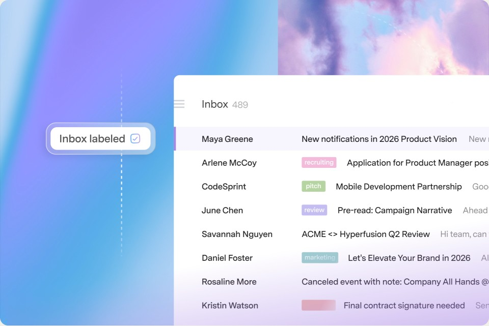
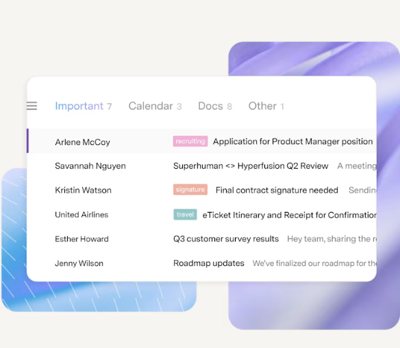
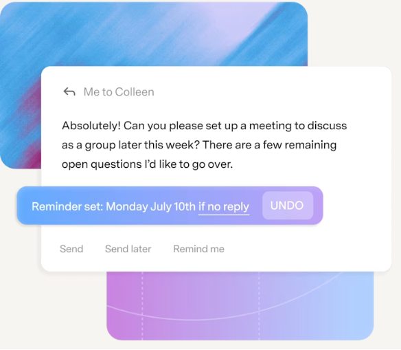
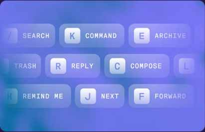
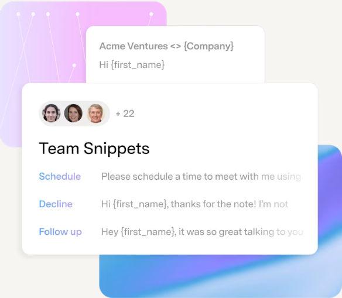

# Superhuman Mail and AMC

Public-source field study, 22 November 2026. AMC baseline is `8efb958` on `main`. AMC status comes from the checked-in desktop, Engine and CLI entry points. The [build plan](../plan.md) and [desktop audit](../desktop-react-audit.md) describe plans and historical measurements, so shipped status follows the code where they differ. Superhuman registration and live account tests were out of scope. Product behavior is documented or inferred from identified public evidence. [1](https://github.com/ralfboltshauser/agent-mail-client/tree/8efb958a5892c27e71a0e5af1f1f5d9ec094d352 "AMC revision audited")

## 1. Executive summary

Ranked by how much the idea could improve the owner's ability to decide, defer, and delegate. The first three build directly on working AMC paths.

1. **Measure the critical keyboard loop.** Instrument key-to-visible-result for opening a cached Thread, cursor movement, Archive, and focusing a new composer. Start with a proposed p95 under 100 ms on a seeded Mac fixture and report the share within 50 ms. Test rapid sequences separately from individual keystrokes. [2](https://blog.superhuman.com/performance-metrics-for-blazingly-fast-web-apps/ "Performance metrics") [3](https://blog.superhuman.com/game-design-not-gamification/ "Founder on interaction and empty states")
2. **Build a follow-up queue around actual commitments.** Add a compose-time no-reply reminder, show pending versus due follow-ups, and let a scoped Agent propose the time and an editable draft when the condition fires. Test reply detection separately for Gmail and IMAP. [4](https://help.superhuman.com/hc/en-us/articles/46005666142733-Remind-Me "Remind Me") [5](https://help.superhuman.com/hc/en-us/articles/46005658551053-Auto-Reminders-Auto-Drafts "Auto Reminders and Auto Drafts")
3. **Show triage corrections before they take effect.** Let the owner preview how new examples or rules classify recent Threads, mark mistakes, and see what changed. Start with replay against the existing Buckets and Interrupt decisions. [6](https://help.superhuman.com/hc/en-us/articles/46005657758861-Auto-Labels "Auto Labels and live preview")
4. **Make evidence-linked mail questions a first-class action.** Start from AMC's existing search and read tools, cap retrieval to selected Accounts, and link answers to the exact Threads used. A query such as “What did I promise Maya?” should lead back to the source message. [7](https://help.superhuman.com/hc/en-us/articles/46005676610829-Ask-AI "Ask AI") [8](https://help.superhuman.com/hc/en-us/articles/46005696690317-Superhuman-Mail-MCP-Server "Mail MCP tools and permissions")
5. **Put Agent Draft review where the Thread is read.** Show drafting, ready, stale and failed states near the relevant message. Offer a changed-text view and explain when a new inbound message makes a draft stale. Keep delivery an explicit owner action. [5](https://help.superhuman.com/hc/en-us/articles/46005658551053-Auto-Reminders-Auto-Drafts "Auto Reminders and Auto Drafts") [9](https://help.superhuman.com/hc/en-us/articles/46005583725709-Instant-Reply "Instant Reply") [10](https://help.superhuman.com/hc/en-us/articles/46005696084109-Team-Features-Overview "Team overview")
6. **Save useful inbox views over Buckets.** Start with named combinations of Account, Label and Bucket for a project or a batch of low-priority mail. Pin one and switch to it with the keyboard. Keep the Unified Inbox available throughout. [11](https://help.superhuman.com/hc/en-us/articles/46005619081101-Default-Split-Inbox "Default Split Inbox") [12](https://help.superhuman.com/hc/en-us/articles/46005636204941-Custom-Split-Inbox "Custom Split Inbox")
7. **Teach shortcuts through actions.** Show the direct key in palette results and after repeated mouse or palette use. Offer a short fixture-based first run spanning a Bucket correction, undo and Handoff. [13](https://blog.superhuman.com/the-fastest-way-to-inbox-zero-a-single-coaching-session/ "Concierge onboarding, 2021") [14](https://help.superhuman.com/hc/en-us/articles/46005793127181-Get-Started-with-Superhuman-Mail "Get started guide") [15](https://superhuman.com/mail/shortcuts "Official shortcut reference")
8. **Add reusable, reviewable reply Snippets.** Let the owner and scoped Agents insert a named template with visible placeholders and source. Start with body text and avoid implicit recipient or attachment changes in the first version. [16](https://help.superhuman.com/hc/en-us/articles/46005686571149-Snippets "Snippets") [17](https://new.superhuman.com/ "Mail release notes")
9. **Show which work is truly clear.** Give a drained Reply or Action Bucket a calm completion state and expose the next pending follow-up. Keep loading, offline, filtered-empty and cleared states distinct in the UI. [3](https://blog.superhuman.com/game-design-not-gamification/ "Founder on interaction and empty states") [18](https://help.superhuman.com/hc/en-us/articles/47439134613773-Mark-Done "Mark Done")
10. **Make search filters discoverable.** Surface parsable examples and editable filters for people, dates, Labels and attachment presence. Keep keyword results inspectable when an Agent answer is also available. [19](https://help.superhuman.com/hc/en-us/articles/46005672652301-Search "Search and operators") [7](https://help.superhuman.com/hc/en-us/articles/46005676610829-Ask-AI "Ask AI")

## 2. Superhuman Mail overview

- **Product and workflow.** The public product presents an email client for Google and Microsoft mail, designed around speed, follow-through and collaboration. Inbox Zero is a decision loop: clear work that is complete, defer it to a time, or record the next action. Default Splits separate people and priority mail from automated traffic, while user-defined Splits batch related work. Cmd+K on Mac and Ctrl+K on Windows bridge discoverability and muscle memory. The founder describes the design through concrete goals, reliable controls and flow. [20](https://superhuman.com/mail "Mail product page") [21](https://superhuman.com/learn/email/inbox-zero-method "Inbox Zero method") [11](https://help.superhuman.com/hc/en-us/articles/46005619081101-Default-Split-Inbox "Default Split Inbox") [15](https://superhuman.com/mail/shortcuts "Official shortcut reference") [3](https://blog.superhuman.com/game-design-not-gamification/ "Founder on interaction and empty states")
- **Local responsiveness and sync, historical implementation.** In 2016 the team described a Service Worker serving offline assets, with a mix of CacheStorage, WebSQL and LocalStorage for caching. WebSQL held mail metadata and bodies. The team combined cached mail with optimistic local modifiers, an ordered queue per Thread, idempotent persistence, disk-backed replay after closing, and rollback on terminal failure. A Chrome extension coordinated persistence between tabs in that implementation. Later public writing confirms a database of mail in the browser or app and a target of under 100 ms, aiming for under 50 ms where possible. The metrics post uses latency bands around 50, 100 and 1,000 ms to make regressions visible. These are company targets and examples. Current storage engine, IndexedDB usage by surface, replica scope, reconciliation protocol and full offline feature coverage are unverified. [22](https://blog.superhuman.com/architecting-a-web-app-to-just-work-offline-part-1/ "Offline architecture, 2016") [23](https://blog.superhuman.com/superhuman-is-built-for-speed/ "100 ms design target") [2](https://blog.superhuman.com/performance-metrics-for-blazingly-fast-web-apps/ "Performance metrics")
- **Clients and releases.** A 2021 engineering interview describes JavaScript, React and Electron on desktop. Current help lists Mac, Windows, Chrome, iOS and Android availability. September 2026 release notes describe the mobile navigation redesign and desktop theme refresh. October adds mobile calendar viewing options. The public Mail release feed records MCP additions for attachments, reminders, Snippets and sharing. The 2021 stack is historical evidence. [24](https://softwareengineeringdaily.com/wp-content/uploads/2021/03/SED1219-Superhuman-Eng.pdf "Engineering interview, 2021") [25](https://help.superhuman.com/hc/en-us/articles/46005778798605-Download-Superhuman-Mail "Client availability") [26](https://connect.superhuman.com/t/changelog-september-2026/61455 "September 2026 release") [27](https://connect.superhuman.com/t/changelog-october-2026/61705 "October 2026 release") [17](https://new.superhuman.com/ "Mail release notes")
- **Onboarding.** In 2021, a specialist listened to the owner's pain points, customized splits and walked through real triage without the mouse in an approximately 30-minute call. The current help provides self-serve guidance, and pricing distinguishes starter group coaching, business private-group coaching and enterprise priority one-to-one coaching. The old concierge format is a design precedent. [13](https://blog.superhuman.com/the-fastest-way-to-inbox-zero-a-single-coaching-session/ "Concierge onboarding, 2021") [14](https://help.superhuman.com/hc/en-us/articles/46005793127181-Get-Started-with-Superhuman-Mail "Get started guide") [28](https://superhuman.com/plans/mail "Mail plans")
- **Pricing.** Mail Starter is US$30 monthly or $300 yearly ($25/month equivalent). Business is $40 monthly or $396 yearly ($33/month equivalent). Enterprise is sales-quoted. Starter includes core email productivity, calendar, collaboration and much of the AI suite. Business adds Auto Drafts, Ask AI, Mail MCP, custom AI Auto Labels, Recent Opens and CRM features. Enterprise lists controls and support including SSO and priority coaching. Suite Free and Pro list other products without Mail. Pricing and entitlements are a snapshot. [29](https://help.superhuman.com/hc/en-us/articles/46178817646861-Pricing-Plans "Billing help") [28](https://superhuman.com/plans/mail "Mail plans") [30](https://superhuman.com/plans "Suite plans") [17](https://new.superhuman.com/ "Mail release notes")

## 3. Feature-by-feature gaps

**Has** marks a working AMC entry point for the core job. **Partial** marks coverage with a material gap or constraint. **Missing** means no first-class equivalent surfaced in the audited checkout. Effort measures the proposed AMC idea for one engineer familiar with the repo. S is a narrow change, M crosses UI and Engine or requires focused product work, and L adds a new client, protocol or persistent workflow. These are relative estimates.

| Area | Superhuman feature | AMC today | Inspiration idea for AMC | Effort | Source |
| --- | --- | --- | --- | --- | --- |
| Latency | Local display and explicit interaction latency bands | **Partial.** Virtualized list, replica selectors and renderer regression harness. The [React audit](../desktop-react-audit.md#keep-it-that-way) calls for separate Electron latency measurements. | Key-to-paint benchmarks for hot and cold paths at realistic mailbox sizes. | M | [23](https://blog.superhuman.com/superhuman-is-built-for-speed/ "100 ms design target") [2](https://blog.superhuman.com/performance-metrics-for-blazingly-fast-web-apps/ "Performance metrics") |
| Offline and sync | Cached reads and optimistic disk-backed replay in documented historical design | **Has.** Desktop [SQLite replica](../../apps/desktop/src/main/replica.ts), [sync](../../apps/desktop/src/main/sync.ts) and [durable Organise overlay](../../apps/desktop/src/main/organise.ts). Search and older bodies have Engine paths. | Document offline coverage by action and exercise retry, restart and stale content continuity. | M | [22](https://blog.superhuman.com/architecting-a-web-app-to-just-work-offline-part-1/ "Offline architecture, 2016") [23](https://blog.superhuman.com/superhuman-is-built-for-speed/ "100 ms design target") |
| Command palette | Contextual Cmd/Ctrl+K actions and shortcut hints | **Has.** [Palette](../../apps/desktop/src/renderer/src/components/command-palette.tsx) and [contextual actions](../../apps/desktop/src/renderer/src/features/mailbox/use-mail-commands.ts) include Buckets, undo and Handoff. | Rank by context, expose aliases and use the same command definition for discovery and dispatch. | M | [13](https://blog.superhuman.com/the-fastest-way-to-inbox-zero-a-single-coaching-session/ "Concierge onboarding, 2021") [15](https://superhuman.com/mail/shortcuts "Official shortcut reference") |
| Keyboard | Single letters, multi-key navigation and published reference | **Has.** [Hotkeys](../../apps/desktop/src/renderer/src/hooks/use-hotkeys.ts), [mail commands](../../apps/desktop/src/renderer/src/features/mailbox/use-mail-commands.ts) and [shortcut dialog](../../apps/desktop/src/renderer/src/components/shortcuts-dialog.tsx). | Test rapid transitions from C or R into typing, and teach commonly repeated actions in context. | S | [15](https://superhuman.com/mail/shortcuts "Official shortcut reference") [3](https://blog.superhuman.com/game-design-not-gamification/ "Founder on interaction and empty states") |
| Important / Other | Default person-to-person and automated mail splits with correction | **Partial.** [Bucketing](../../apps/desktop/src/renderer/src/components/bucket-picker.tsx) expresses the next action. Interrupt and a dedicated Quiet view are described in the [plan](../plan.md#73-triage). The current desktop [notification path](../../apps/desktop/src/main/notifications.ts) does not use that classifier. | Explain notification treatment independently of where a Thread is filed. Make silent arrivals inspectable. | S | [11](https://help.superhuman.com/hc/en-us/articles/46005619081101-Default-Split-Inbox "Default Split Inbox") [31](https://help.superhuman.com/hc/en-us/articles/46005707869965-Moving-Conversations-Between-Important-and-Other "Move between Important and Other") |
| Split Inbox | Default library and saved custom definitions that can overlap | **Partial.** [Sidebar](../../apps/desktop/src/renderer/src/components/app-sidebar.tsx) has Accounts, Labels and Buckets. No named saved rule combinations surfaced. | Pin a saved view from the current filter. Include explicit matching rules and counts. | M | [11](https://help.superhuman.com/hc/en-us/articles/46005619081101-Default-Split-Inbox "Default Split Inbox") [12](https://help.superhuman.com/hc/en-us/articles/46005636204941-Custom-Split-Inbox "Custom Split Inbox") |
| Organise | Mark Done, mute, labels and sender cleanup | **Has** for core Thread actions via [Organise](../../apps/desktop/src/renderer/src/components/organise.tsx), [Engine mutations](../../apps/engine/src/mail/mutations.ts) and [CLI](../../apps/cli/src/main.ts). | Add keyboard-friendly selection scope and keep failure and undo visible while advancing. | M | [18](https://help.superhuman.com/hc/en-us/articles/47439134613773-Mark-Done "Mark Done") [32](https://help.superhuman.com/hc/en-us/articles/46005597483661-Muting-Conversations "Mute") |
| Sender cleanup | Unsubscribe and block | **Missing** as dedicated owner commands in [Organise](../../apps/desktop/src/renderer/src/components/organise.tsx). | Start with explicit, owner-reviewed sender rules and a visible suppressed-mail history. | M | [33](https://help.superhuman.com/hc/en-us/articles/46005635358349-Dealing-with-Unwanted-Emails "Unsubscribe and block") |
| Backlog | Get Me To Zero bulk archives older mail with a seven-day reversal via Bulk Actions | **Partial.** [Organise](../../apps/desktop/src/renderer/src/components/organise.tsx) supports Archive and undo. No age-based backlog wizard surfaced. | Preview exact scope, protect flagged Threads, record a reversible bulk operation. | M | [18](https://help.superhuman.com/hc/en-us/articles/47439134613773-Mark-Done "Mark Done") [34](https://help.superhuman.com/hc/en-us/articles/46005611576589-Mass-Archive "Mass Archive") |
| Snooze | Time deferral from the triage flow and natural-language reminder entry | **Has.** [Desktop Organise](../../apps/desktop/src/renderer/src/components/organise.tsx) and [CLI](../../apps/cli/src/main.ts) use Engine Snooze. [Engine setting](../../apps/engine/src/config.ts) defaults on. IMAP Snooze is restricted to Inbox Threads. | Support typed time with date, timezone and weekday confirmation. | S | [20](https://superhuman.com/mail "Mail product page") [4](https://help.superhuman.com/hc/en-us/articles/46005666142733-Remind-Me "Remind Me") [3](https://blog.superhuman.com/game-design-not-gamification/ "Founder on interaction and empty states") |
| Follow-ups | Remind Me from an existing reply draft, no-reply or regardless, with returned reminders in a split | **Partial.** [Snooze](../../apps/engine/src/mail/mutations.ts) has no-reply state and a wake path. The [composer footer](../../apps/desktop/src/renderer/src/features/composer/footer.tsx) lacks a reminder control, and no distinct due queue surfaced. | Tie pending and due reminders to the Follow-up Bucket and show the reply that stopped a reminder. | M | [4](https://help.superhuman.com/hc/en-us/articles/46005666142733-Remind-Me "Remind Me") |
| Send Later | Scheduled delivery with optional no-reply condition. Smart Send recommends times based on activity and timezone | **Has** for clock-based scheduling through the [composer footer](../../apps/desktop/src/renderer/src/features/composer/footer.tsx) and [Engine Outbox](../../apps/engine/src/mail/outbox.ts). No reply condition in the enqueue flow. | Add explicit send-if-no-reply with owner review of cancellation rules and ambiguous sync cases. | M | [20](https://superhuman.com/mail "Mail product page") [35](https://help.superhuman.com/hc/en-us/articles/46005572688525-Smart-Send "Smart Send and conditional delivery") |
| Undo | Z reverses last action or undoes send inside the documented ten-second window | **Has.** [Organise undo](../../apps/desktop/src/renderer/src/components/organise.tsx) and [Send undo](../../apps/desktop/src/renderer/src/features/mailbox/send-undo.ts). [Engine settings](../../apps/engine/src/settings.ts) default to ten seconds. | Name the exact action and remaining deadline. Teach the keyboard recovery path through feedback. | S | [36](https://help.superhuman.com/hc/en-us/articles/46005666743309-Undo "Undo") |
| Read statuses | Tracks opens and offers Recent Opens; a tracking signal is an imperfect proxy for reading | **Missing** for outgoing tracking. [Reader](../../apps/desktop/src/renderer/src/components/message-body.tsx) blocks incoming remote images by default and offers an explicit reveal. | Use owner-visible reply and reminder state to inform follow-up decisions. | S | [37](https://help.superhuman.com/hc/en-us/articles/46005603745293-Read-Statuses-and-Recent-Opens-Feed "Read Statuses and Recent Opens") [38](https://news.ycombinator.com/item?id=20349604 "Hacker News read-tracking discussion, 2019") |
| Snippets | Text, placeholders and optional attachments or recipient fields, with personal and team reuse | **Missing.** [Draft details](../../apps/desktop/src/renderer/src/features/composer/draft-details.tsx) implements signatures. No Snippet library in the composer path. | Add named, body-only templates with explicit placeholder validation and scoped Agent read. | M | [16](https://help.superhuman.com/hc/en-us/articles/46005686571149-Snippets "Snippets") [17](https://new.superhuman.com/ "Mail release notes") |
| Compose | Signature management, Quick Quote, autocomplete and correction | **Partial.** [Composer](../../apps/desktop/src/renderer/src/components/composer.tsx), [recipient field](../../apps/desktop/src/renderer/src/components/recipient-field.tsx) and [editor](../../apps/desktop/src/renderer/src/features/composer/editor.tsx) cover rich drafting, recipient suggestions and signatures. | Insert a selected quote without losing reply context or draft focus. | S | [39](https://help.superhuman.com/hc/en-us/articles/46005692763661-Quick-Quote "Quick Quote") [40](https://help.superhuman.com/hc/en-us/articles/46005771841933-Signatures "Signatures") [20](https://superhuman.com/mail "Mail product page") |
| Introductions | Instant Intro helps reply to an introduction and moves the introducer to Bcc | **Missing** as a dedicated workflow in [compose commands](../../apps/desktop/src/renderer/src/features/mailbox/use-mail-commands.ts). | Offer an owner-reviewable introduction reply with visible envelope changes. | S | [41](https://help.superhuman.com/hc/en-us/articles/46005674036877-Instant-Intro "Instant Intro") |
| Write with AI | Prompt-to-draft and edit actions with voice and style personalization | **Partial.** [Handoff](../agents/handoff.md) and [MCP](../../apps/engine/src/mcp/server.ts) can create or write drafts. No first-class inline rewrite controls surfaced. | Owner-selected rewrite with a diff and one explicit apply action through a Harness. | M | [42](https://help.superhuman.com/hc/en-us/articles/46005557122957-Write-with-AI "Write with AI") [43](https://help.superhuman.com/hc/en-us/articles/46005802896781-Personalization "Personalization") |
| Ask AI / AI search | Natural-language answers across mail, calendar and web, with up to five years of indexed mail | **Partial.** [Engine search](../../apps/engine/src/mail/queries.ts) and [MCP](../../apps/engine/src/mcp/server.ts) support Agent retrieval. No embedded question-to-evidence flow surfaced. | Provide a first-class, Account-scoped answer card with Thread evidence and a visible search query. | M | [7](https://help.superhuman.com/hc/en-us/articles/46005676610829-Ask-AI "Ask AI") [8](https://help.superhuman.com/hc/en-us/articles/46005696690317-Superhuman-Mail-MCP-Server "Mail MCP tools and permissions") |
| Auto Summarize | One line under the subject and expandable bullets | **Partial.** [Triage](../../apps/cli/src/triage.ts) supplies short summaries for selected recent Threads and [row](../../apps/desktop/src/renderer/src/features/thread-list/thread-row.tsx) displays triage context. | Offer an on-demand brief with source messages, refresh on new mail and display freshness. | M | [44](https://help.superhuman.com/hc/en-us/articles/46005642123917-Auto-Summarize "Auto Summarize") |
| Auto Labels | Deterministic or prompt-based labels with real-time preview, corrections and limited backfill | **Partial.** [Desktop auto-triage](../../apps/desktop/src/main/auto-triage.ts), [CLI triage](../../apps/cli/src/triage.ts) and [Bucket routes](../../apps/engine/src/http/buckets.ts) cover the existing Bucket classifier with examples. | Replay new examples on a bounded recent sample and show affected Bucket and Interrupt results before activation. | M | [6](https://help.superhuman.com/hc/en-us/articles/46005657758861-Auto-Labels "Auto Labels and live preview") |
| Auto Archive | Archive by Auto Label, sender or domain, with exception controls | **Partial.** Agents can issue scoped Archive via [MCP](../../apps/engine/src/mcp/server.ts). No owner-facing automatic rule editor surfaced. | Start with dry-run suggestions and exception rules. Show history and per-rule undo. | M | [45](https://help.superhuman.com/hc/en-us/articles/46005662460813-Auto-Archive "Auto Archive") |
| Auto Reminders and Auto Drafts | Detects mail needing follow-up or response and prepares drafts, including scheduling drafts | **Partial.** [Triage](../runbook.md#mail-triage) and [Agent Draft permissions](../agents/permissions.md#shipped-in-m6-v1) exist. The [Host runner](../agents/headless.md#what-blocks-scheduled-triage) is deferred. | Let the owner enable predictable draft triggers once job-level isolation is ready. Recheck Thread state before writing. | L | [5](https://help.superhuman.com/hc/en-us/articles/46005658551053-Auto-Reminders-Auto-Drafts "Auto Reminders and Auto Drafts") |
| Instant Reply | Three short suggested replies beneath the most recent message | **Partial.** [Thread View](../../apps/desktop/src/renderer/src/components/thread-view.tsx) supports reading and accessing drafts. It has no suggestion chooser. | Show one low-friction suggestion with provenance where triage marked the Thread Reply. | M | [9](https://help.superhuman.com/hc/en-us/articles/46005583725709-Instant-Reply "Instant Reply") |
| Knowledge Base | Adds personal and company context to AI answers and composing | **Partial.** [T3 Handoff](../agents/handoff.md) uses a chosen project's context. No general AMC knowledge library surfaced. | Make the selected project and any cited source visible in the draft review. | M | [46](https://help.superhuman.com/hc/en-us/articles/46005666866829-Knowledge-Base "Knowledge Base") [43](https://help.superhuman.com/hc/en-us/articles/46005802896781-Personalization "Personalization") |
| Keyword search | Search operators and suggested syntax in the sidebar | **Partial.** [Desktop search](../../apps/desktop/src/renderer/src/features/search/use-mail-search.ts), [Engine FTS](../../apps/engine/src/mail/queries.ts), and CLI/MCP filters operate at different entry points. | Expose shared query semantics and edit sender, recipient, date, Label and attachment filters in place. | M | [19](https://help.superhuman.com/hc/en-us/articles/46005672652301-Search "Search and operators") |
| Calendar | Inbox sidebar, availability sharing, event creation, AI scheduling and mobile views | **Missing** in the [desktop command surface](../../apps/desktop/src/renderer/src/features/mailbox/use-mail-commands.ts) and [Engine routes](../../apps/engine/src/http/app.ts). | Start with an owner-authorized availability read and reviewable meeting proposal in the draft. | L | [47](https://help.superhuman.com/hc/en-us/articles/46005615985293-Calendar-Overview "Calendar overview") [48](https://help.superhuman.com/hc/en-us/articles/46005621734669-Create-Event "Create Event") [49](https://help.superhuman.com/hc/en-us/articles/46005575115021-Share-Availability "Share Availability") [7](https://help.superhuman.com/hc/en-us/articles/46005676610829-Ask-AI "Ask AI") [27](https://connect.superhuman.com/t/changelog-october-2026/61705 "October 2026 release") |
| Contacts | Contact Pane enriches people with social data and recent conversations | **Partial.** [Contact search](../../apps/engine/src/mail/drafts.ts) and [recipient suggestions](../../apps/desktop/src/renderer/src/components/recipient-field.tsx). | Show recent correspondence and chosen project context directly from data the owner already has. | M | [50](https://help.superhuman.com/hc/en-us/articles/46005778939789-Contact-Pane "Contact Pane") |
| Notifications | Desktop high-priority option with default split; mobile per Account and selected Splits | **Partial.** [Mac alerts](../../apps/desktop/src/main/notifications.ts) batch new unread Inbox messages and check Mute and quiet hours. They do not gate on the triage Interrupt value. The [tray](../../apps/desktop/src/main/tray.ts) is present. Mobile delivery and the dedicated Quiet view are absent. | Wire Interrupt decisions to notification delivery, then show which messages were silent and why. | M | [51](https://help.superhuman.com/hc/en-us/articles/46185909973517-Email-Notifications "Email notifications and badges") |
| Multiple accounts | Account switching with native tabs as the documented Unified Inbox workaround | **Has** a true Unified Inbox plus Account filtering and Gmail/IMAP/SMTP provider paths through [sidebar](../../apps/desktop/src/renderer/src/components/app-sidebar.tsx), [Engine accounts](../../apps/engine/src/accounts.ts) and [CLI](../../apps/cli/src/main.ts). | Keep cross-Account selection and clearly show the sending Account in every review. | S | [52](https://help.superhuman.com/hc/en-us/articles/46005777934733-Managing-Accounts "Managing Accounts") [53](https://help.superhuman.com/hc/en-us/articles/46005722297229-Unified-Inbox-Workaround "Unified Inbox workaround") [20](https://superhuman.com/mail "Mail product page") |
| Mobile | iOS and Android apps with swipe triage, pull-to-command and dedicated Mail, Search and Calendar navigation | **Missing.** Android is named in the [plan scope](../plan.md); the audited checkout ships desktop, CLI and Engine. | Start Android with Interrupt, Reply and Follow-up review linked to a single Thread. | L | [25](https://help.superhuman.com/hc/en-us/articles/46005778798605-Download-Superhuman-Mail "Client availability") [54](https://help.superhuman.com/hc/en-us/articles/46005842694541-Swipe-Your-Way-to-Inbox-Zero "Mobile triage guide") [26](https://connect.superhuman.com/t/changelog-september-2026/61455 "September 2026 release") |
| Desktop platforms | Mac, Windows and Chrome web client | **Partial.** [Runbook](../runbook.md#mac-desktop-app) documents the Mac app; [build config](../../apps/desktop/electron-builder.json) is Mac-oriented. | Measure demand before broadening distribution. Keep shortcut definitions portable in the meantime. | L | [25](https://help.superhuman.com/hc/en-us/articles/46005778798605-Download-Superhuman-Mail "Client availability") [55](https://help.superhuman.com/hc/en-us/articles/46005544514061-Keyboard-Shortcuts-Not-Working "Shortcut troubleshooting") |
| Teams and sharing | Shared Threads with comments and guests, team Snippets, reply collision signals and shared drafts viewable live | **Partial.** [Handoff and Composer Link](../agents/handoff.md) cover owner-to-Agent collaboration. No human teams, guest Thread shares or thread comments surfaced. | Bring reply collision and visible participant scope into the owner–Agent review flow. | M | [10](https://help.superhuman.com/hc/en-us/articles/46005696084109-Team-Features-Overview "Team overview") [56](https://help.superhuman.com/hc/en-us/articles/46005593675917-Shared-Conversations-and-Team-Comments "Shared Conversations and Team Comments") [57](https://help.superhuman.com/hc/en-us/articles/46005578703885-Shared-Drafts "Shared Drafts") |
| Onboarding | Self-serve guides, coaching and historical concierge setup | **Partial.** [Pair screen](../../apps/desktop/src/renderer/src/components/pair-screen.tsx) and [Runbook](../runbook.md#mac-desktop-app) get a Client connected. | Add an optional first-run practice mailbox with representative decisions and reversible outcomes. | M | [14](https://help.superhuman.com/hc/en-us/articles/46005793127181-Get-Started-with-Superhuman-Mail "Get started guide") [13](https://blog.superhuman.com/the-fastest-way-to-inbox-zero-a-single-coaching-session/ "Concierge onboarding, 2021") [28](https://superhuman.com/plans/mail "Mail plans") |
| Settings | Command-discoverable AI, theme, calendar, notification and team settings | **Partial.** [Mail settings](../../apps/desktop/src/renderer/src/components/mail-settings.tsx), theme, per-Account signature and CLI Account setup. | Index settings in the palette and show whether each affects this Client, an Account or the Engine. | S | [58](https://help.superhuman.com/hc/en-us/articles/46005763646093-Theme "Theme settings") [59](https://help.superhuman.com/hc/en-us/articles/46005588676237-Superhuman-AI-Overview "AI feature and data overview") [51](https://help.superhuman.com/hc/en-us/articles/46185909973517-Email-Notifications "Email notifications and badges") [17](https://new.superhuman.com/ "Mail release notes") |
| Accessibility | International keyboard guidance and updated contrast. Conformance, full screen-reader behavior and motion settings unverified | **Partial.** [Reader controls](../../apps/desktop/src/renderer/src/features/mailbox/reader-toolbar.tsx), [hotkeys](../../apps/desktop/src/renderer/src/hooks/use-hotkeys.ts), and [reduced-motion styling](../../apps/desktop/src/renderer/src/styles.css) give testable starting points. | Test VoiceOver, focus recovery, contrast and QWERTZ/AltGr with single-key shortcuts and an off switch. | M | [60](https://help.superhuman.com/hc/en-us/articles/46005584339597-Shortcuts-for-International-Keyboards "International shortcuts") [55](https://help.superhuman.com/hc/en-us/articles/46005544514061-Keyboard-Shortcuts-Not-Working "Shortcut troubleshooting") [26](https://connect.superhuman.com/t/changelog-september-2026/61455 "September 2026 release") |
| Theme and density | Light, dark and system modes, refreshed contrast, and compact mobile list option | **Partial.** [Theme hook](../../apps/desktop/src/renderer/src/hooks/use-theme.ts), [styles](../../apps/desktop/src/renderer/src/styles.css) and [mail panes](../../apps/desktop/src/renderer/src/features/mailbox/mail-panes.tsx). | Let users choose list density and make selection, unread and attention signals distinct. | M | [58](https://help.superhuman.com/hc/en-us/articles/46005763646093-Theme "Theme settings") [61](https://blog.superhuman.com/how-to-design-delightful-dark-themes/ "Dark theme design") [26](https://connect.superhuman.com/t/changelog-september-2026/61455 "September 2026 release") [17](https://new.superhuman.com/ "Mail release notes") |
| Privacy and security | Hosted processing, provider OAuth, security controls by plan, and a third-party mail store when Ask AI is enabled | **Has** self-hosting, [privacy model](../../PRIVACY.md), [credential boundary](../adr/0003-engine-runs-as-its-own-user.md), and scoped grants. Hosted enterprise controls are a different operating model. | Show where data will go for each Agent action and make retention and revocation visible. | M | [62](https://superhuman.com/legal/dpa "Data Privacy Addendum, November 2026") [28](https://superhuman.com/plans/mail "Mail plans") [59](https://help.superhuman.com/hc/en-us/articles/46005588676237-Superhuman-AI-Overview "AI feature and data overview") |
| Integrations | CRM, other external tools, and Mail MCP for external Agent clients | **Partial.** [T3 Handoff](../runbook.md#t3-handoff), Engine [MCP](../../apps/engine/src/mcp/server.ts) and [CLI](../../apps/cli/src/main.ts). No native CRM workflow surfaced. | Add narrow project or CRM lookup through owner-scoped tools when a repeated workflow justifies it. | M | [63](https://help.superhuman.com/hc/en-us/articles/46005542018829-Other-Integrations "Other integrations") [64](https://help.superhuman.com/hc/en-us/articles/44999426280333-Salesforce "Salesforce") [8](https://help.superhuman.com/hc/en-us/articles/46005696690317-Superhuman-Mail-MCP-Server "Mail MCP tools and permissions") |
| Agent control | MCP supports read, draft, shared work, reminders and gated `send_draft` | **Has** scoped read/organize/draft, [Agent activity](../../apps/desktop/src/renderer/src/components/agent-activity.tsx) and an Engine [tool boundary](../agents/permissions.md#shipped-in-m6-v1) without send. | Publish example workflows and a visible capability receipt with Account, operation, target, expiry and revocation. | M | [8](https://help.superhuman.com/hc/en-us/articles/46005696690317-Superhuman-Mail-MCP-Server "Mail MCP tools and permissions") [17](https://new.superhuman.com/ "Mail release notes") |

## 4. UI and workflow observations

Figures 1–5 are headless Chrome captures of public Superhuman product imagery. Figure 6 is a public historical illustration from the founder's blog. Product imagery uses illustrative mail and may simplify the interface. The notes below describe visible details and label interpretations. [20](https://superhuman.com/mail "Mail product page") [3](https://blog.superhuman.com/game-design-not-gamification/ "Founder on interaction and empty states")

### Inbox hierarchy and density

*Figure 1. Captured frame from Superhuman Mail's public hero animation. Credit: Superhuman.* [20](https://superhuman.com/mail "Mail product page")

*Figure 2. Split Inbox marketing image. Credit: Superhuman.* [20](https://superhuman.com/mail "Mail product page")

In Figures 1 and 2, a shallow header exposes the active list and count. Rows place sender, subject, optional short Label and preview on one line. A slender rail accent marks the current row, and the active Split gains color in the tab strip. The sans-serif typography gets its hierarchy from weight, contrast and alignment. The screenshots do not identify the production font or exact dimensions. The product page and Contact Pane documentation also show contextual information beside the mail rather than on a separate screen. For AMC, a density option should preserve clear selection and make Bucket, read state and Interrupt visually distinct even when all three apply. [20](https://superhuman.com/mail "Mail product page") [12](https://help.superhuman.com/hc/en-us/articles/46005636204941-Custom-Split-Inbox "Custom Split Inbox") [50](https://help.superhuman.com/hc/en-us/articles/46005778939789-Contact-Pane "Contact Pane")

The dark-theme write-up shows how the team used surface lightness for depth and removed a saturated overlay that distracted from a reminder dialog. September's release notes describe a contrast and readability refresh. Both are design evidence from particular dates. [61](https://blog.superhuman.com/how-to-design-delightful-dark-themes/ "Dark theme design") [26](https://connect.superhuman.com/t/changelog-september-2026/61455 "September 2026 release")

### Motion, feedback and keyboard recall

*Figure 3. Marketing illustration of a conditional reminder confirmation. Credit: Superhuman.* [20](https://superhuman.com/mail "Mail product page")

*Figure 4. Marketing illustration of shortcuts. Credit: Superhuman. The official reference supplies modifier combinations.* [20](https://superhuman.com/mail "Mail product page") [15](https://superhuman.com/mail/shortcuts "Official shortcut reference")

The hero video animates attention toward changes such as applied Labels. Figure 3 shows a task-level confirmation that repeats the time and condition and puts Undo beside it. The Undo help documents the mobile affordance and the desktop Z deadline. Public footage cannot establish production transition durations, easing, or compositor behavior. The founder describes queuing early keystrokes across a compose transition. Preserve caret, selection and the next keystroke while the next view mounts. Keep outcome feedback readable without motion. [20](https://superhuman.com/mail "Mail product page") [36](https://help.superhuman.com/hc/en-us/articles/46005666743309-Undo "Undo") [3](https://blog.superhuman.com/game-design-not-gamification/ "Founder on interaction and empty states")

Figure 4 explains the keyboard vocabulary. The historical onboarding walkthrough describes the stronger teaching loop: find a command by name, run it and see the shortcut for next time. The official reference covers multi-key sequences and the help center covers international keyboard differences. AMC already shows hints in the palette. The incremental opportunity is to teach the next useful action in the workspace, with an equivalent pointer path. [13](https://blog.superhuman.com/the-fastest-way-to-inbox-zero-a-single-coaching-session/ "Concierge onboarding, 2021") [15](https://superhuman.com/mail/shortcuts "Official shortcut reference") [60](https://help.superhuman.com/hc/en-us/articles/46005584339597-Shortcuts-for-International-Keyboards "International shortcuts")

*Figure 5. Team Snippets marketing illustration. Credit: Superhuman.* [20](https://superhuman.com/mail "Mail product page")

The card gives each reusable response a short verb and one line of preview. The help details text variables and more powerful Snippet effects such as adding recipients or attachments. AMC can make previews and unresolved placeholders visible in its existing review flow. [20](https://superhuman.com/mail "Mail product page") [16](https://help.superhuman.com/hc/en-us/articles/46005686571149-Snippets "Snippets")

### Empty states and closure

*Figure 6. Historical Inbox Zero illustration published by Superhuman. Credit: Superhuman and the image rights holder. The source does not identify the photographer beside this figure.* [3](https://blog.superhuman.com/game-design-not-gamification/ "Founder on interaction and empty states") [65](https://storage.ghost.io/c/c7/8e/c78e4b36-4930-4765-917f-f40bc2da20ee/content/images/2023/05/Inbox-Zero.webp "Public Inbox Zero image asset")

Vohra describes imagery as a reward for clearing the queue. Mark Done documentation also gives users a reversible path to recover from a large backlog. An AMC completion state can report what the owner actually finished and preserve context about pending reminders or failures. Reserve the completion state for a confirmed empty queue. [3](https://blog.superhuman.com/game-design-not-gamification/ "Founder on interaction and empty states") [18](https://help.superhuman.com/hc/en-us/articles/47439134613773-Mark-Done "Mark Done")

## 5. User behavior

Review reports and public comments are self-selected. Some G2 samples are incentivized, independent write-ups may include referral links, and vendor demos show designed workflows. Use them to find jobs and failure modes rather than estimate how often those jobs occur or how much time the average user saves. [66](https://www.g2.com/products/superhuman-mail/reviews "G2 review corpus") [67](https://nicklafferty.com/reviews/superhuman/ "Nick Lafferty’s six-year review") [68](https://www.youtube.com/watch?v=LdRmUOsgFgY "Vendor AI workflow walkthrough")

- **Speed and repetition.** G2 reviewer Igor S. wrote that shortcuts let him “fly through emails without ever touching the mouse.” In the same review he calls out premium cost, the learning curve and friction across Accounts. The November 2026 review mix on G2 surfaces speed and shortcuts alongside expense and learning curve. [66](https://www.g2.com/products/superhuman-mail/reviews "G2 review corpus")
- **The user has to learn the commands.** Brett M. reports, “It took me a few weeks to remember which keys to press.” The opportunity is faster time to first successful action and shorter lookup time while forming the habit. [66](https://www.g2.com/products/superhuman-mail/reviews "G2 review corpus")
- **Follow-through persists after novelty.** Nick Lafferty writes, “The shortcuts and scheduled follow-ups are still the features I use most.” In a Reddit discussion about switching to Apple Mail, a user values reusing text in “a couple of keystrokes.” Both point to repeated work with a stable action and a concrete payoff. [67](https://nicklafferty.com/reviews/superhuman/ "Nick Lafferty’s six-year review") [69](https://www.reddit.com/r/macapps/comments/1gmkg2r/thinking_of_leaving_superhuman_for_apple_mail/ "Reddit workflow and alternatives discussion")
- **Value depends on volume and stakes.** A Reddit participant says the calculation depends on “how much value can be derived from your emails, and how many emails you get.” The firsthand Tom's Guide article describes using and evaluating AI replies, reminders and open tracking. These are individual accounts. [70](https://www.reddit.com/r/macapps/comments/1b16eex/can_anyone_actually_justify_the_costbenefit_of/ "Reddit cost and volume discussion") [71](https://www.tomsguide.com/ai/superhuman-email-can-generate-emails-send-reminders-and-more-heres-how-to-sign-up "Tom’s Guide firsthand review")
- **Read tracking and rendering have trust costs.** The 2019 Hacker News debate shows objections to invisible recipient tracking. Treat it as historical sentiment and use the current Help Center for feature behavior. In G2, Ashley v. reports resorting to Gmail to see an inline customer reply. A single report leaves the cause undetermined. [38](https://news.ycombinator.com/item?id=20349604 "Hacker News read-tracking discussion, 2019") [37](https://help.superhuman.com/hc/en-us/articles/46005603745293-Read-Statuses-and-Recent-Opens-Feed "Read Statuses and Recent Opens") [66](https://www.g2.com/products/superhuman-mail/reviews "G2 review corpus")

**Workflows to test with AMC owners**

1. **Clear an active queue.** Start in the high-priority view, move by keyboard and pick Done, reply, or reminder. Batch the other split later. The vendor's walkthrough and guides show the taught workflow. AMC can measure decisions per minute and the proportion recovered successfully after undo. [72](https://www.youtube.com/watch?v=BjFNAKB-720 "Inbox Zero walkthrough") [73](https://help.superhuman.com/hc/en-us/articles/46005833597709-Achieve-Inbox-Zero "Achieve Inbox Zero") [18](https://help.superhuman.com/hc/en-us/articles/47439134613773-Mark-Done "Mark Done")
2. **Close the loop after sending.** Set a no-reply reminder from a reply, find pending reminders, and review the returned Thread or draft when it is due. The vendor AI walkthrough shows follow-up alongside Auto Labels and Auto Archive. AMC can track skipped reminders, explanations and stale drafts. [4](https://help.superhuman.com/hc/en-us/articles/46005666142733-Remind-Me "Remind Me") [68](https://www.youtube.com/watch?v=LdRmUOsgFgY "Vendor AI workflow walkthrough") [5](https://help.superhuman.com/hc/en-us/articles/46005658551053-Auto-Reminders-Auto-Drafts "Auto Reminders and Auto Drafts")
3. **Repeat a routine response or hand it off.** Insert a template, check placeholders, and send. When a response needs project context, share the scope and agree who owns the draft before anyone acts. The equivalent AMC task pairs Snippets with a project Handoff and owner review. [16](https://help.superhuman.com/hc/en-us/articles/46005686571149-Snippets "Snippets") [10](https://help.superhuman.com/hc/en-us/articles/46005696084109-Team-Features-Overview "Team overview") [56](https://help.superhuman.com/hc/en-us/articles/46005593675917-Shared-Conversations-and-Team-Comments "Shared Conversations and Team Comments")

## 6. What AMC already does differently

- **Handoff carries the project and a narrow permission.** AMC's T3 flow starts with one Thread and an explicit project, issues a four-hour grant for Thread read and reply-body editing, and creates an expiring Composer Link. A replacement Handoff revokes the previous credentials. Superhuman also has external Agent integrations and live shared drafts. Its help says only the original author can edit a human-shared draft. Compare those workflows by who can change the live draft and where project context comes from. [AMC Handoff](../runbook.md#t3-handoff). [8](https://help.superhuman.com/hc/en-us/articles/46005696690317-Superhuman-Mail-MCP-Server "Mail MCP tools and permissions") [57](https://help.superhuman.com/hc/en-us/articles/46005578703885-Shared-Drafts "Shared Drafts")
- **Agents have a send-free tool surface today.** Current AMC grants can read, organize and draft, and reviewed delivery uses the paired desktop owner path. The ADR's future approval gate is a design. Superhuman documents a `send_draft` tool, a read-only mode and configurable assistant approval. Show those differences plainly when users grant access. [AMC permissions](../agents/permissions.md#shipped-in-m6-v1), [ADR 0001](../adr/0001-agents-cannot-send-by-construction.md). [8](https://help.superhuman.com/hc/en-us/articles/46005696690317-Superhuman-Mail-MCP-Server "Mail MCP tools and permissions")
- **The owner runs the Engine.** AMC's Host owns the mailbox replica and provider credentials. External Harnesses may still process mail the owner authorizes them to read. Superhuman's DPA describes its service processing and the AI docs describe third-party storage with Ask AI. AMC can use its self-hosted architecture to make each data transfer visible. [AMC privacy policy](../../PRIVACY.md), [Engine account isolation](../adr/0003-engine-runs-as-its-own-user.md), [Harness ADR](../adr/0002-agents-run-through-the-owners-harness.md). [62](https://superhuman.com/legal/dpa "Data Privacy Addendum, November 2026") [59](https://help.superhuman.com/hc/en-us/articles/46005588676237-Superhuman-AI-Overview "AI feature and data overview")
- **Attention and Account aggregation are independent.** AMC combines a Unified Inbox, an Account selector and action-oriented Buckets. The glossary distinguishes Interrupt from Quiet. The current alert path still batches eligible new unread Inbox mail, so dependable attention gating remains an opportunity. Superhuman documents per-Account switching, a tab workaround for a Unified Inbox, and per-Split notification options on mobile. [AMC glossary](../../GLOSSARY.md), [sidebar](../../apps/desktop/src/renderer/src/components/app-sidebar.tsx), [notifications](../../apps/desktop/src/main/notifications.ts). [53](https://help.superhuman.com/hc/en-us/articles/46005722297229-Unified-Inbox-Workaround "Unified Inbox workaround") [51](https://help.superhuman.com/hc/en-us/articles/46185909973517-Email-Notifications "Email notifications and badges")
- **Recovery is already part of delivery.** AMC has reviewable draft revisions, durable queued sends, configurable undo and an Outbox resolution path for uncertainty. Superhuman's Undo docs give users a fixed ten-second window. AMC can surface its recovery state directly during the keyboard loop. [Outbox](../../apps/engine/src/mail/outbox.ts), [delivery resolution](../../apps/desktop/src/renderer/src/features/delivery/resolve-delivery.tsx), [settings](../../apps/engine/src/settings.ts). [36](https://help.superhuman.com/hc/en-us/articles/46005666743309-Undo "Undo")

## 7. References

1. [AMC revision audited](https://github.com/ralfboltshauser/agent-mail-client/tree/8efb958a5892c27e71a0e5af1f1f5d9ec094d352) — accessed 2026-11-22.
2. [Performance metrics](https://blog.superhuman.com/performance-metrics-for-blazingly-fast-web-apps/) — accessed 2026-11-22.
3. [Founder on interaction and empty states](https://blog.superhuman.com/game-design-not-gamification/) — accessed 2026-11-22.
4. [Remind Me](https://help.superhuman.com/hc/en-us/articles/46005666142733-Remind-Me) — accessed 2026-11-22.
5. [Auto Reminders and Auto Drafts](https://help.superhuman.com/hc/en-us/articles/46005658551053-Auto-Reminders-Auto-Drafts) — accessed 2026-11-22.
6. [Auto Labels and live preview](https://help.superhuman.com/hc/en-us/articles/46005657758861-Auto-Labels) — accessed 2026-11-22.
7. [Ask AI](https://help.superhuman.com/hc/en-us/articles/46005676610829-Ask-AI) — accessed 2026-11-22.
8. [Mail MCP tools and permissions](https://help.superhuman.com/hc/en-us/articles/46005696690317-Superhuman-Mail-MCP-Server) — accessed 2026-11-22.
9. [Instant Reply](https://help.superhuman.com/hc/en-us/articles/46005583725709-Instant-Reply) — accessed 2026-11-22.
10. [Team overview](https://help.superhuman.com/hc/en-us/articles/46005696084109-Team-Features-Overview) — accessed 2026-11-22.
11. [Default Split Inbox](https://help.superhuman.com/hc/en-us/articles/46005619081101-Default-Split-Inbox) — accessed 2026-11-22.
12. [Custom Split Inbox](https://help.superhuman.com/hc/en-us/articles/46005636204941-Custom-Split-Inbox) — accessed 2026-11-22.
13. [Concierge onboarding, 2021](https://blog.superhuman.com/the-fastest-way-to-inbox-zero-a-single-coaching-session/) — accessed 2026-11-22.
14. [Get started guide](https://help.superhuman.com/hc/en-us/articles/46005793127181-Get-Started-with-Superhuman-Mail) — accessed 2026-11-22.
15. [Official shortcut reference](https://superhuman.com/mail/shortcuts) — accessed 2026-11-22.
16. [Snippets](https://help.superhuman.com/hc/en-us/articles/46005686571149-Snippets) — accessed 2026-11-22.
17. [Mail release notes](https://new.superhuman.com/) — accessed 2026-11-22.
18. [Mark Done](https://help.superhuman.com/hc/en-us/articles/47439134613773-Mark-Done) — accessed 2026-11-22.
19. [Search and operators](https://help.superhuman.com/hc/en-us/articles/46005672652301-Search) — accessed 2026-11-22.
20. [Mail product page](https://superhuman.com/mail) — accessed 2026-11-22.
21. [Inbox Zero method](https://superhuman.com/learn/email/inbox-zero-method) — accessed 2026-11-22.
22. [Offline architecture, 2016](https://blog.superhuman.com/architecting-a-web-app-to-just-work-offline-part-1/) — accessed 2026-11-22.
23. [100 ms design target](https://blog.superhuman.com/superhuman-is-built-for-speed/) — accessed 2026-11-22.
24. [Engineering interview, 2021](https://softwareengineeringdaily.com/wp-content/uploads/2021/03/SED1219-Superhuman-Eng.pdf) — accessed 2026-11-22.
25. [Client availability](https://help.superhuman.com/hc/en-us/articles/46005778798605-Download-Superhuman-Mail) — accessed 2026-11-22.
26. [September 2026 release](https://connect.superhuman.com/t/changelog-september-2026/61455) — accessed 2026-11-22.
27. [October 2026 release](https://connect.superhuman.com/t/changelog-october-2026/61705) — accessed 2026-11-22.
28. [Mail plans](https://superhuman.com/plans/mail) — accessed 2026-11-22.
29. [Billing help](https://help.superhuman.com/hc/en-us/articles/46178817646861-Pricing-Plans) — accessed 2026-11-22.
30. [Suite plans](https://superhuman.com/plans) — accessed 2026-11-22.
31. [Move between Important and Other](https://help.superhuman.com/hc/en-us/articles/46005707869965-Moving-Conversations-Between-Important-and-Other) — accessed 2026-11-22.
32. [Mute](https://help.superhuman.com/hc/en-us/articles/46005597483661-Muting-Conversations) — accessed 2026-11-22.
33. [Unsubscribe and block](https://help.superhuman.com/hc/en-us/articles/46005635358349-Dealing-with-Unwanted-Emails) — accessed 2026-11-22.
34. [Mass Archive](https://help.superhuman.com/hc/en-us/articles/46005611576589-Mass-Archive) — accessed 2026-11-22.
35. [Smart Send and conditional delivery](https://help.superhuman.com/hc/en-us/articles/46005572688525-Smart-Send) — accessed 2026-11-22.
36. [Undo](https://help.superhuman.com/hc/en-us/articles/46005666743309-Undo) — accessed 2026-11-22.
37. [Read Statuses and Recent Opens](https://help.superhuman.com/hc/en-us/articles/46005603745293-Read-Statuses-and-Recent-Opens-Feed) — accessed 2026-11-22.
38. [Hacker News read-tracking discussion, 2019](https://news.ycombinator.com/item?id=20349604) — accessed 2026-11-22.
39. [Quick Quote](https://help.superhuman.com/hc/en-us/articles/46005692763661-Quick-Quote) — accessed 2026-11-22.
40. [Signatures](https://help.superhuman.com/hc/en-us/articles/46005771841933-Signatures) — accessed 2026-11-22.
41. [Instant Intro](https://help.superhuman.com/hc/en-us/articles/46005674036877-Instant-Intro) — accessed 2026-11-22.
42. [Write with AI](https://help.superhuman.com/hc/en-us/articles/46005557122957-Write-with-AI) — accessed 2026-11-22.
43. [Personalization](https://help.superhuman.com/hc/en-us/articles/46005802896781-Personalization) — accessed 2026-11-22.
44. [Auto Summarize](https://help.superhuman.com/hc/en-us/articles/46005642123917-Auto-Summarize) — accessed 2026-11-22.
45. [Auto Archive](https://help.superhuman.com/hc/en-us/articles/46005662460813-Auto-Archive) — accessed 2026-11-22.
46. [Knowledge Base](https://help.superhuman.com/hc/en-us/articles/46005666866829-Knowledge-Base) — accessed 2026-11-22.
47. [Calendar overview](https://help.superhuman.com/hc/en-us/articles/46005615985293-Calendar-Overview) — accessed 2026-11-22.
48. [Create Event](https://help.superhuman.com/hc/en-us/articles/46005621734669-Create-Event) — accessed 2026-11-22.
49. [Share Availability](https://help.superhuman.com/hc/en-us/articles/46005575115021-Share-Availability) — accessed 2026-11-22.
50. [Contact Pane](https://help.superhuman.com/hc/en-us/articles/46005778939789-Contact-Pane) — accessed 2026-11-22.
51. [Email notifications and badges](https://help.superhuman.com/hc/en-us/articles/46185909973517-Email-Notifications) — accessed 2026-11-22.
52. [Managing Accounts](https://help.superhuman.com/hc/en-us/articles/46005777934733-Managing-Accounts) — accessed 2026-11-22.
53. [Unified Inbox workaround](https://help.superhuman.com/hc/en-us/articles/46005722297229-Unified-Inbox-Workaround) — accessed 2026-11-22.
54. [Mobile triage guide](https://help.superhuman.com/hc/en-us/articles/46005842694541-Swipe-Your-Way-to-Inbox-Zero) — accessed 2026-11-22.
55. [Shortcut troubleshooting](https://help.superhuman.com/hc/en-us/articles/46005544514061-Keyboard-Shortcuts-Not-Working) — accessed 2026-11-22.
56. [Shared Conversations and Team Comments](https://help.superhuman.com/hc/en-us/articles/46005593675917-Shared-Conversations-and-Team-Comments) — accessed 2026-11-22.
57. [Shared Drafts](https://help.superhuman.com/hc/en-us/articles/46005578703885-Shared-Drafts) — accessed 2026-11-22.
58. [Theme settings](https://help.superhuman.com/hc/en-us/articles/46005763646093-Theme) — accessed 2026-11-22.
59. [AI feature and data overview](https://help.superhuman.com/hc/en-us/articles/46005588676237-Superhuman-AI-Overview) — accessed 2026-11-22.
60. [International shortcuts](https://help.superhuman.com/hc/en-us/articles/46005584339597-Shortcuts-for-International-Keyboards) — accessed 2026-11-22.
61. [Dark theme design](https://blog.superhuman.com/how-to-design-delightful-dark-themes/) — accessed 2026-11-22.
62. [Data Privacy Addendum, November 2026](https://superhuman.com/legal/dpa) — accessed 2026-11-22.
63. [Other integrations](https://help.superhuman.com/hc/en-us/articles/46005542018829-Other-Integrations) — accessed 2026-11-22.
64. [Salesforce](https://help.superhuman.com/hc/en-us/articles/44999426280333-Salesforce) — accessed 2026-11-22.
65. [Public Inbox Zero image asset](https://storage.ghost.io/c/c7/8e/c78e4b36-4930-4765-917f-f40bc2da20ee/content/images/2023/05/Inbox-Zero.webp) — accessed 2026-11-22.
66. [G2 review corpus](https://www.g2.com/products/superhuman-mail/reviews) — accessed 2026-11-22.
67. [Nick Lafferty’s six-year review](https://nicklafferty.com/reviews/superhuman/) — accessed 2026-11-22.
68. [Vendor AI workflow walkthrough](https://www.youtube.com/watch?v=LdRmUOsgFgY) — accessed 2026-11-22.
69. [Reddit workflow and alternatives discussion](https://www.reddit.com/r/macapps/comments/1gmkg2r/thinking_of_leaving_superhuman_for_apple_mail/) — accessed 2026-11-22.
70. [Reddit cost and volume discussion](https://www.reddit.com/r/macapps/comments/1b16eex/can_anyone_actually_justify_the_costbenefit_of/) — accessed 2026-11-22.
71. [Tom’s Guide firsthand review](https://www.tomsguide.com/ai/superhuman-email-can-generate-emails-send-reminders-and-more-heres-how-to-sign-up) — accessed 2026-11-22.
72. [Inbox Zero walkthrough](https://www.youtube.com/watch?v=BjFNAKB-720) — accessed 2026-11-22.
73. [Achieve Inbox Zero](https://help.superhuman.com/hc/en-us/articles/46005833597709-Achieve-Inbox-Zero) — accessed 2026-11-22.
