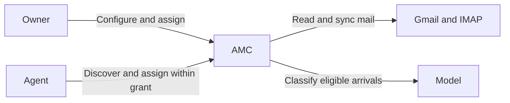
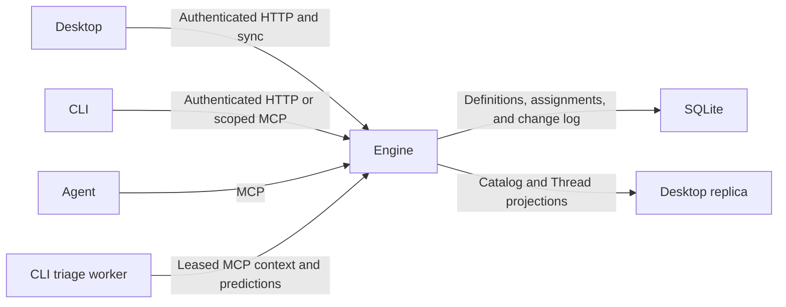
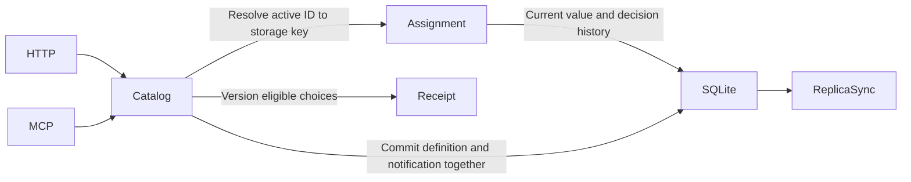

# Custom Buckets

**Status:** Proposed implementation plan. The defaults below are design recommendations. [Current behavior and GitHub research](../research/custom-buckets.md)

## Product behavior

The owner can create a Bucket such as **Receipts** in Desktop Settings, from a paired CLI, or through an owner-authorized MCP session. It appears in the Triage sidebar, command palette, assignment picker, and review choices across Accounts. Every Thread still has at most one Bucket. Assigning Receipts replaces that Thread's previous Bucket and updates AMC's replica. Provider labels, folders, and Inbox membership are separate.

- **Scope and identity.** One catalog per Engine, shared across Accounts. Unified and Account views use the same Bucket IDs and count only Threads in the current Account filter. Keep the seven built-ins and their existing behavior. Each custom Bucket has an immutable ID, a unique display name, an optional triage description, an automatic-assignment flag, and an order among custom Buckets. Validate trimmed names and descriptions server-side, reserve built-in names and `clear` under case-insensitive normalization, and cap field lengths and catalog size. Use generated opaque IDs for custom Buckets.
- **Assignment.** Every active Bucket is assignable by the owner. Automatic assignment is opt-in per custom Bucket and requires a description of when to use it. The existing global auto-triage setting still controls whether the worker runs. Turning off automatic assignment takes effect on future classifications. Existing assignments stay in place. Existing keys 1–7 remain stable. Custom choices are reachable by typing or keyboard navigation regardless of order.
- **Lifecycle.** Rename, edit the description, reorder, archive, and restore. Archiving removes a Bucket from new assignment choices and normal sidebar navigation. Its assigned Threads still show the Bucket and can be opened through **Archived Buckets** in Settings. Restore makes it assignable again, with automatic assignment off until the owner enables it. An archived name stays reserved. Omit hard deletion and bulk reassignment from the first release. Existing revision-checked Undo may restore a previous archived assignment.
- **Inbox.** A custom Bucket gets a sidebar view. Its Threads follow the existing New senders, Other mail, and Seen rules. Reply, Action, and Follow-up retain their special routing by built-in ID. A dedicated Inbox section per Bucket would be a separate setting and needs explicit ordering and precedence against New senders and Seen. [Inbox routing](../../apps/desktop/src/renderer/src/data/thread-queries.ts#L122)

## Engine and client contract

Add a Bucket catalog module in the Engine. Give it a small interface for reading definitions, editing the catalog, resolving assignable IDs, and producing the eligible triage choices. HTTP, MCP, and triage call that same implementation. The Engine owns validation, permissions, revisions, and lifecycle. The CLI has no separate configuration file for Bucket settings. Desktop owns unsaved form values and a cached catalog for reading offline. [Existing Engine settings](../../apps/engine/src/settings.ts), [owner authorization](../../apps/engine/src/http/app.ts#L317)

| Surface | Proposed contract |
| --- | --- |
| Owner HTTP | Read `GET /v1/buckets`. Create via `POST /v1/buckets`; edit, archive or restore via `PATCH /v1/buckets/:id`; set custom order with `PUT /v1/buckets/order`. Return the accepted definition or order and catalog revision. Mutations require paired owner admin. |
| Assign and review | Extend `PUT /v1/bucket` with a versioned ID input, `bucketId: string \| null`. Keep its owner manual, owner review, and agent paths, including existing input revisions, action IDs, reasons, account checks, and review Undo. Resolve IDs and eligibility inside the write transaction. |
| Desktop Settings | Add **Triage → Buckets** with built-in, custom, and archived rows. Create or edit a name and description, toggle automatic assignment, reorder with keyboard-accessible controls, archive or restore, and open an archived view. Show validation errors inline. Preserve unsaved input on conflicts or connection loss. Apply the Engine's accepted revision and keep focus on the edited row. |
| CLI management | `amc buckets list [--archived] [--json]`, `show <id>`, `create <name> [--description ...] [--auto]`, `edit <id> [--name ...] [--description ...] [--auto\|--no-auto]`, `reorder <ids...>`, `archive <id>`, and `restore <id>`. All subcommands support machine-readable output. Use the paired owner session for management. Keep `amc bucket` for assignment and clear, extending it to resolve active names and take an explicit stable ID. IDs are the scripting interface. |
| MCP discovery and assignment | Expose `list_buckets` to eligible read grants and ID-aware `set_bucket_by_id` to eligible organize grants. Scoped CLI assignment uses the same tools. A direct assignment may use any active Bucket the grant can assign. The auto flag governs the classifier. Keep legacy `set_bucket` accepting built-in names. Resolve the target Thread's Account server-side and enforce the existing grant constraints and write limits. Handoff and composer credentials retain their narrower tool set. |
| MCP management | Register `create_bucket`, `update_bucket`, and `reorder_buckets` only for a paired owner-admin principal. Archive and restore are explicit state transitions on the update tool. Match the HTTP fields and errors. Agent grants and the classifier's forwarded tools exclude management. |

Require an expected catalog revision for edits and reordering. Show a conflict with the latest revision and require the caller to reapply the intended edit. Use a client request ID for create so a retry after a lost response returns the original result. Increment revisions and record sync changes atomically. An accepted no-op leaves the revision untouched. Use typed errors for invalid fields, duplicate names, archived definitions, stale revisions, and missing IDs. [Current Bucket route](../../apps/engine/src/http/buckets.ts#L12), [MCP registration](../../apps/engine/src/mcp/server.ts#L85), [current CLI assignment](../../apps/cli/src/main.ts#L483)

## Persist and sync

1. **Preserve existing assignments.** Seed the catalog with the seven built-ins, using their existing decision-label IDs. Introduce a disjoint namespace such as `bucket.custom.<uuid>`. Reuse the existing nullable Thread column as the storage key: built-ins keep their legacy strings and custom assignments store their ID. Resolve both through the catalog module and expose only canonical IDs in new contracts. This avoids a rewrite of Thread rows, the Bucket trigger, and old correction snapshots. Cover SQL consumers explicitly, including untriaged selection, confidence metadata, corrections, IMAP reimport and merge, history, and search. Archive keeps the definition available to these readers. [SQLite columns](../../apps/engine/src/db/migrations.ts#L486), [revision trigger](../../apps/engine/src/mail/triage/migration.ts#L13), [IMAP reimport](../../apps/engine/src/providers/imap/threading.ts#L100)
2. **Version the projection.** Add an optional ID-keyed assignment field to Thread summaries, details, search results, and MCP reads, while preserving the legacy enum field for built-ins. Legacy clients see custom assignments as absent. The Engine still treats those Threads as assigned and rejects a legacy set or clear on a custom assignment with an upgrade error. Verify that legacy low-confidence review queues also respect that limitation. New clients can read built-in names from older Engines and label management as requiring an Engine upgrade.
3. **Replicate one versioned catalog snapshot.** Advertise the capability to authenticated clients. Add a catalog entity to the existing snapshot and changes protocol for clients that opt in. Legacy feeds omit the entity and still advance the cursor across its entries. Desktop bootstraps it with the replica, publishes a single revision to the renderer, and caches it per pairing. Rebootstrap the projections when switching to the new protocol. Retry and resnapshot use the existing sync paths. A catalog edit never rewrites or republishes every affected Thread. Resolve display names from the cached catalog and key views, queries, counts, rows, and persisted navigation by ID. Ensure a Thread arriving ahead of its definition has a temporary display fallback and resolves when the catalog arrives. [Engine sync](../../apps/engine/src/http/sync.ts#L53), [Desktop sync](../../apps/desktop/src/main/sync.ts#L386), [replica filters](../../apps/desktop/src/main/replica.ts#L386)
4. **Carry stable IDs through history.** Keep historical decision IDs and the `bucket.clear` event label. Validate custom IDs against definitions when writing events. Render historical names from the catalog, including archived definitions, and use a safe fallback when a name cannot be resolved. If the historical display name matters for audit, make that an explicit decision about event metadata and export semantics. Avoid exposing owner-only descriptions in thread projections, telemetry, or arbitrary agent discovery. [Decision labels](../../packages/protocol/src/decision-labels.ts#L4), [history contract](../../packages/protocol/src/triage-history.ts)

## Automatic triage

Negotiate a new triage context version between Engine and worker. Return only active, auto-enabled custom choices plus the applicable built-ins. Build the model's enum from that snapshot and bind eligible IDs and their classification revisions to the signed receipt. Pass descriptions separately as bounded prompt data and keep the model's tool permissions intact. Preserve built-in next-step semantics and include only eligible Bucket examples. Update dry-run and diagnostics to explain which definitions were effective.

When a prediction comes back, check the lease, captured Thread input, owner decisions, and definition eligibility before applying the Bucket. An archive, an auto-disable, or a change to a classification description makes predictions against the affected definition stale. A rename or reorder alone has no effect on eligibility. Log the decision ID and definition revision through the existing history path. Preserve the independent Filter result when only the custom Bucket became stale and the underlying Thread input still qualifies. Keep the old triage contract built-in-only during the rollout. [Triage receipt](../../apps/engine/src/mail/triage/model.ts#L136), [broker schema and prompt](../../apps/cli/src/triage.ts#L346), [current prompt meanings](../../apps/cli/prompts/triage.md#L5)

## Build and verify

| Slice | Deliverable and acceptance |
| --- | --- |
| 1. Engine foundation | Catalog migration and module, legacy-compatible projections, ID-aware assignment, owner control, and history. Test upgrade from a populated database with built-ins, pending Undo, and IMAP reimport data. Verify rename preserves IDs and confidence, archive preserves existing assignments, retry creates exactly one definition, concurrent stale writes fail, and permissions reject cross-account or unauthorized grants. |
| 2. Desktop, CLI, and MCP | Ship management and assignment across all three surfaces with catalog sync. Create Receipts in the CLI, see it appear in an already-open Desktop, assign via MCP, then rename and archive via Settings. Confirm CLI and MCP report the same revision and Desktop retains assignment and navigation by ID. Check readable offline cache, slow and out-of-order responses, pairing changes, search, archived view counts, and legacy-client visibility and write rejection. Use synthetic mail to verify sidebar, picker, review, reader, and focus, selection, scroll, and DOM continuity under sync. |
| 3. Automatic assignment | Add negotiated context, prompt and schema generation, validation, and dry-run. Test a stale description, archive or disable during the lease, retry, unavailable or forged IDs, existing assignments, concurrent owner correction, independent Filter, and legacy-worker fallback. Verify that opt-in affects newly eligible work and triggers no historical reclassification. |
| 4. Release and documentation | Document Settings, CLI help and examples, MCP permissions, mixed-version behavior, and the upgrade sequence. Run affected Engine, CLI, and renderer suites, Biome, and the Mac verification gate. Upgrade the Engine before clients. Leave custom writes disabled until migration and compatibility are verified. Once custom assignments exist, an Engine downgrade needs a compatible build or a pre-migration restore under the runbook; an older binary cannot safely interpret the custom keys. |

[Desktop React budgets](../desktop-react-audit.md) · [CLI documentation](../agents/cli.md) · [Release and recovery runbook](../runbook.md)

## Architecture review

Baseline is commit `7da9439`.

The existing Thread column preserves old correction snapshots and IMAP reimport keys. A separate canonical assignment column would require migration and dual-write handling for each existing writer. A catalog revision remains separate from Thread revisions so edits avoid mass invalidation. The sync response carries an optional catalog snapshot alongside Thread deltas and uses the same global cursor for both. This lets legacy replicas ignore catalog edits while still moving past them.
